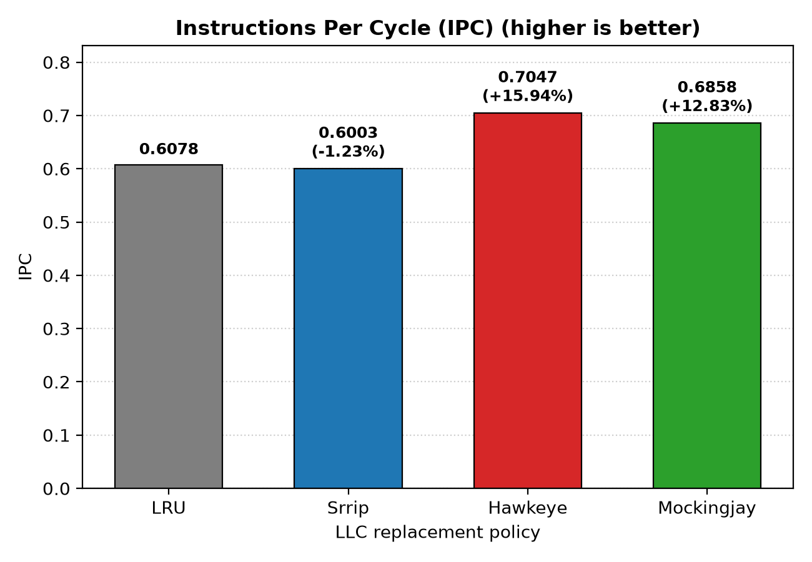

# Impact of LLC Replacement Policies on CPU-Based LLM Decoding

CS683 (Autumn 2026) project, IIT Bombay.

## Overview
Benchmark and get insight how LLC replacement policies (LRU, SRRIP, Mockingjay, Hawkeye)
affect CPU-based LLM decoding across LLC size and context lengths,
using ChampSim and Intel Pin traces of Qwen2.5-0.5B-Instruct on llama.cpp.

## Status
- Phase 1 (checkpoint I): fixed LLC config, four policies, MPKI / IPC / misses
- Phase 2 (checkpoint II): increase LLC size  and context-length (planned)

## Repository layout
| Path | Contents |
|---|---|
| `replacement/` | LLC policies: `srrip.llc_repl`, `mockingjay.llc_repl`, `hawkeye.llc_repl` |
| `inc/` | ChampSim headers, plus `hawkeye_predictor.h` and `optgen.h` needed by Hawkeye |
| `script_me/` | `generate_trace.sh`, `run_simulation.sh`, `output_parsing.py`, `plots_generation.py` |
| `patches/` | `llama.patch`: local changes to llama.cpp |
| `results/` | Raw ChampSim stats per policy |
| `plots/` | Generated figures (IPC, speedup, LLC dMPKI, miss reduction, DRAM GB/s) |
| `build_champsim_llc.sh` | Builds ChampSim for a given LLC policy, changed it to accept llc replacement policy as parameter |
| `Containerfile` | Environment definition |

## External dependencies (not in this repo)
| Tool | Version / commit |
|---|---|
| ChampSim (`champsim-upstream/`) | `410cee62d9c429c043ea611325ce00e6c303be2a` |
| llama.cpp | `970b51ce7c9ba5fff0726c5e9994f1c2f0e4eedc` + `patches/llama.patch` |
| Intel Pin | `4.1`, download from Intel |
| Model | Qwen2.5-0.5B-Instruct fp16 GGUF, `(https://huggingface.co/Qwen/Qwen2.5-0.5B-Instruct)` |

## Reproducing results
1. Build llama.cpp (static, debug, no-PIE), apply `patches/llama.patch`.
2. Generate the trace: `script_me/generate_trace.sh`
3. Build ChampSim with a policy: `./build_champsim_llc.sh ${L1D_PREFETCHER} ${L2C_REPLACEMENT} ${LLC_REPLACEMENT} ${BINARY_NAME}`
4. Run: `script_me/run_simulation.sh`
5. Parse and plot: `python script_me/output_parsing.py` then
   `python script_me/plots_generation.py`

## Simulation setup
- LLC: `2048 sets, 16 Way`, warmup `580M` instructions, simulated `1.405B` instructions
- Metrics: LLC misses, MPKI, IPC, DRAM bandwidth

## Results
 

## Phase 2: Why do Hawkeye and Mockingjay speed up decoding?

Phase 1 showed Hawkeye (+15.5%) and Mockingjay (+12.3%) beating LRU, with higher DRAM bandwidth. SRRIP gave no gain (-1.3%). Phase 2 investigates the cause with a series of experiments on the same trace and LLC configuration.

| # | Experiment | What was done | Result |
|---|---|---|---|
| H1 | DRAM read-miss breakdown | Split DRAM read row misses by cause (row closed/invalid, row used by write, other) for each policy | 80% of LRU's row misses are "row closed/invalid" |
| H2 | Free DRAM writes | Made DRAM writes cost nothing and re-ran all four policies | All policies collapse to the same IPC, so the speedup comes from the DRAM write path |
| H3 | Noise check | Repeated runs of LRU and Hawkeye | IPC varies only in the third decimal; the gap stays at 15.5-15.7% |
| H4 | Disable idle-time write mode | Turned off the controller's idle-triggered write mode under LRU | "Closed row" share of misses drops from 80.6% to 3.2% |
| H5 | SRRIP + writeback rule | Gave SRRIP the same writeback handling as Hawkeye/Mockingjay | IPC and idle episodes barely change, so the writeback rule is not the cause |
| H6 | Write count and write clustering | Compared total DRAM writes (LRU vs Mockingjay) and average writes completed per write-mode episode for every policy | Mockingjay sends about 3.3x fewer writes; Hawkeye clusters writes so each episode completes more of them |

**Takeaway:** The gain comes from the DRAM write path, not from LLC hit rate. Under LRU, idle-time write mode is repeatedly started and cancelled, which closes open rows and makes later reads pay full row misses. Mockingjay avoids this with fewer writes, and Hawkeye by clustering them.

## Credits
- ChampSim (Gober et al.)
- Hawkeye (Jain and Lin, ISCA 2016), UT Austin research license; see header in `replacement/hawkeye.llc_repl`
- Mockingjay : https://github.com/ishanashah/Mockingjay -
- SRRIP (Jaleel et al., ISCA 2010)


\
\
\
\
\
\
\
\
\
\
\
\
\
\
\
# ChampSim

ChampSim is a trace-based simulator for microarchitecture research.

Useful trace links:
- Traces (access requires an LDAP ID): https://drive.google.com/drive/folders/1zYchkn-M1auZp_l5wRkIzAcDYPkNtW3H?usp=sharing
- ChampSim wiki: https://champsim.github.io/ChampSim/master/index.html

## Clone the repository

```bash
git clone https://github.com/cs683-iitb-autumn-2026/pa2.git
```

## Compile

To compile ChampSim, specify three parameters: the L1D prefetcher, the L2C replacement policy, and the binary name.

For example, `./build_champsim.sh no lru baseline` builds a single-core processor with a hashed perceptron branch predictor, no L1D data prefetcher, and the LRU replacement policy for the L2C.

You can give the binary any name. Custom names help distinguish binaries that use the same configuration.

```bash
./build_champsim.sh ${L1D_PREFETCHER} ${L2C_REPLACEMENT} ${LLC_REPLACEMENT} ${BINARY_NAME}

./build_champsim.sh no lru mockingjay baseline
```

## Run simulation

```bash
./bin/[BINARY] -warmup_instructions [N_WARM] -simulation_instructions [N_SIM] -traces [TRACE_DIR]/[TRACE]
./bin/hashed_perceptron-no-no-no-no-no-no-no-lru-lru-lru-lru-lru-lru-lru-lru-1core-baseline -warmup_instructions 25000000 -simulation_instructions 25000000 -traces ../traces/trace1.champsimtrace.xz
```

Where:
- `${BINARY}`: ChampSim binary compiled by `build_champsim.sh` (for example, `hashed_perceptron-no-no-no-no-no-no-no-lru-lru-lru-lru-lru-lru-lru-lru-1core-baseline`)
- `${N_WARM}`: number of instructions for the warmup period (25 million)
- `${N_SIM}`: number of instructions for the detailed simulation (25 million)
- `${TRACE_DIR}`: directory containing the trace (for example, `../traces/`)
- `${TRACE}`: name of the trace (for example, `trace1.champsimtrace.xz`)

## Evaluate the simulation

ChampSim measures IPC (instructions per cycle) as its main performance metric. It also prints other useful metrics at the end of each simulation.

## Install GCC 7 on Ubuntu

```bash
sudo apt update
sudo add-apt-repository ppa:ubuntu-toolchain-r/test
vim /etc/apt/sources.list
```

Update the last line with:

```bash
deb [arch=amd64] http://archive.ubuntu.com/ubuntu focal main universe
```

Then run:

```bash
sudo add-apt-repository ppa:ubuntu-toolchain-r/test
sudo apt-get install gcc-7
sudo apt-get install g++-7
sudo update-alternatives --install /usr/bin/g++ g++ /usr/bin/g++-7 0
sudo update-alternatives --install /usr/bin/gcc gcc /usr/bin/gcc-7 0
```

If GCC and G++ are already present in `/usr/bin`, configure the alternatives using:

```bash
sudo update-alternatives --config g++
sudo update-alternatives --config gcc
```

