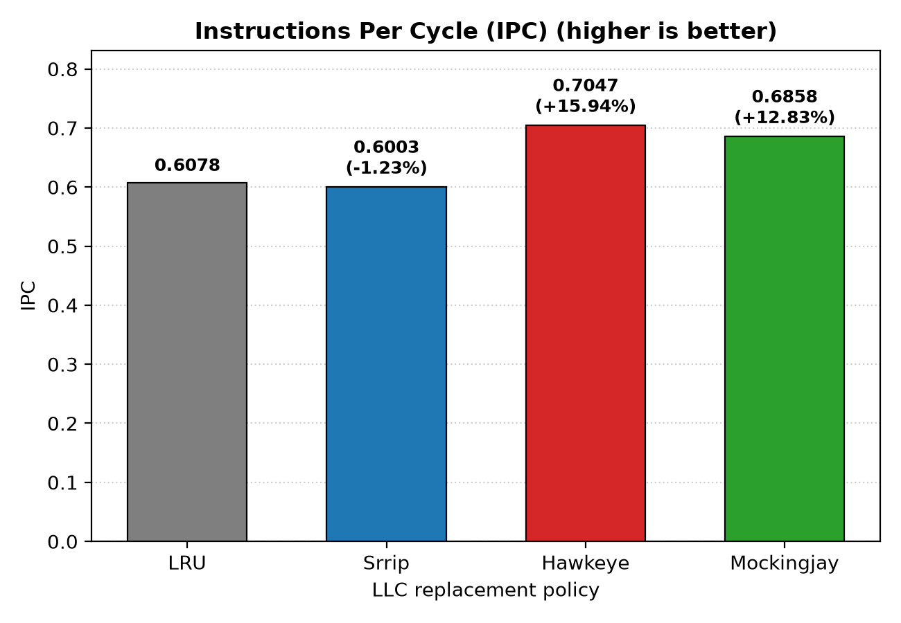

# Impact of LLC Replacement Policies on CPU-Based LLM Decoding

CS683 (Autumn 2026) project, IIT Bombay. Author: Kumar Rajnish (25m2123)

## Overview
Characterizes how LLC replacement policies (LRU, SRRIP, Mockingjay, Hawkeye)
affect CPU-based LLM decoding across LLC capacities and context lengths,
using ChampSim and Intel Pin traces of Qwen2.5-0.5B-Instruct on llama.cpp.

## Status
- Phase 1 (checkpoint I): fixed LLC config, four policies, MPKI / IPC / misses
- Phase 2 (checkpoint II): increase LLC size  and context-length (planned)

## Repository layout
| Path | Contents |
|---|---|
| `replacement/` | LLC policies: `srrip.llc_repl`, `srrip_way.llc_repl`, `mockingjay.llc_repl`, `hawkeye.llc_repl` |
| `inc/` | ChampSim headers, plus `hawkeye_predictor.h` and `optgen.h` needed by Hawkeye |
| `script_me/` | `generate_trace.sh`, `run_simulation.sh`, `output_parsing.py`, `plots_generation.py` |
| `patches/` | `llama.patch`: local changes to llama.cpp |
| `results/` | Raw ChampSim stats per policy |
| `plots/` | Generated figures (IPC, speedup, LLC dMPKI, miss reduction, DRAM GB/s, ...) |
| `build_champsim_llc.sh` | Builds ChampSim for a given LLC policy |
| `Containerfile` | Environment definition |

## External dependencies (not in this repo)
| Tool | Version / commit |
|---|---|
| ChampSim (`champsim-upstream/`) | `<commit hash>` |
| llama.cpp | `<commit hash>` + `patches/llama.patch` |
| Intel Pin | `<version>`, download from Intel |
| Model | Qwen2.5-0.5B-Instruct fp16 GGUF, `<download link>` |

## Reproducing results
1. Build llama.cpp (static, debug, no-PIE), apply `patches/llama.patch`.
2. Generate the trace: `script_me/generate_trace.sh` (single thread, 128 tokens,
   trace only the decode region).
3. Build ChampSim with a policy: `./build_champsim_llc.sh <policy>`
4. Run: `script_me/run_simulation.sh`
5. Parse and plot: `python script_me/output_parsing.py` then
   `python script_me/plots_generation.py`

## Simulation setup
- LLC: `<size, sets, ways>`, warmup `<N>` instructions, simulated `<N>` instructions
- Metrics: LLC misses, MPKI, IPC, token-generation latency, throughput

## Results
<embed a plot, e.g. >

## Credits
- ChampSim (Gober et al.)
- Hawkeye (Jain and Lin, ISCA 2016), UT Austin research license; see header in `replacement/hawkeye.llc_repl`
- Mockingjay : https://github.com/ishanashah/Mockingjay -
- SRRIP (Jaleel et al., ISCA 2010)


\
\
\
\
\
\
\
\
\
\
\
\
\
\
\
# ChampSim

ChampSim is a trace-based simulator for microarchitecture research.

Useful trace links:
- Traces (access requires an LDAP ID): https://drive.google.com/drive/folders/1zYchkn-M1auZp_l5wRkIzAcDYPkNtW3H?usp=sharing
- ChampSim wiki: https://champsim.github.io/ChampSim/master/index.html

## Clone the repository

```bash
git clone https://github.com/cs683-iitb-autumn-2026/pa2.git
```

## Compile

To compile ChampSim, specify three parameters: the L1D prefetcher, the L2C replacement policy, and the binary name.

For example, `./build_champsim.sh no lru baseline` builds a single-core processor with a hashed perceptron branch predictor, no L1D data prefetcher, and the LRU replacement policy for the L2C.

You can give the binary any name. Custom names help distinguish binaries that use the same configuration.

```bash
./build_champsim.sh ${L1D_PREFETCHER} ${L2C_REPLACEMENT} ${LLC_REPLACEMENT} ${BINARY_NAME}

./build_champsim.sh no lru mockingjay baseline
```

## Run simulation

```bash
./bin/[BINARY] -warmup_instructions [N_WARM] -simulation_instructions [N_SIM] -traces [TRACE_DIR]/[TRACE]
./bin/hashed_perceptron-no-no-no-no-no-no-no-lru-lru-lru-lru-lru-lru-lru-lru-1core-baseline -warmup_instructions 25000000 -simulation_instructions 25000000 -traces ../traces/trace1.champsimtrace.xz
```

Where:
- `${BINARY}`: ChampSim binary compiled by `build_champsim.sh` (for example, `hashed_perceptron-no-no-no-no-no-no-no-lru-lru-lru-lru-lru-lru-lru-lru-1core-baseline`)
- `${N_WARM}`: number of instructions for the warmup period (25 million)
- `${N_SIM}`: number of instructions for the detailed simulation (25 million)
- `${TRACE_DIR}`: directory containing the trace (for example, `../traces/`)
- `${TRACE}`: name of the trace (for example, `trace1.champsimtrace.xz`)

## Evaluate the simulation

ChampSim measures IPC (instructions per cycle) as its main performance metric. It also prints other useful metrics at the end of each simulation.

## Install GCC 7 on Ubuntu

```bash
sudo apt update
sudo add-apt-repository ppa:ubuntu-toolchain-r/test
vim /etc/apt/sources.list
```

Update the last line with:

```bash
deb [arch=amd64] http://archive.ubuntu.com/ubuntu focal main universe
```

Then run:

```bash
sudo add-apt-repository ppa:ubuntu-toolchain-r/test
sudo apt-get install gcc-7
sudo apt-get install g++-7
sudo update-alternatives --install /usr/bin/g++ g++ /usr/bin/g++-7 0
sudo update-alternatives --install /usr/bin/gcc gcc /usr/bin/gcc-7 0
```

If GCC and G++ are already present in `/usr/bin`, configure the alternatives using:

```bash
sudo update-alternatives --config g++
sudo update-alternatives --config gcc
```

